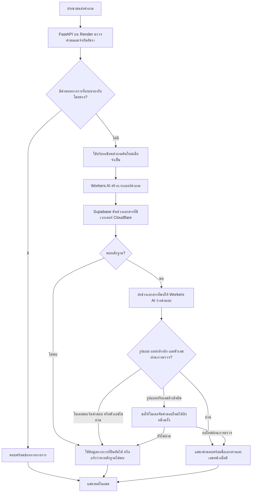
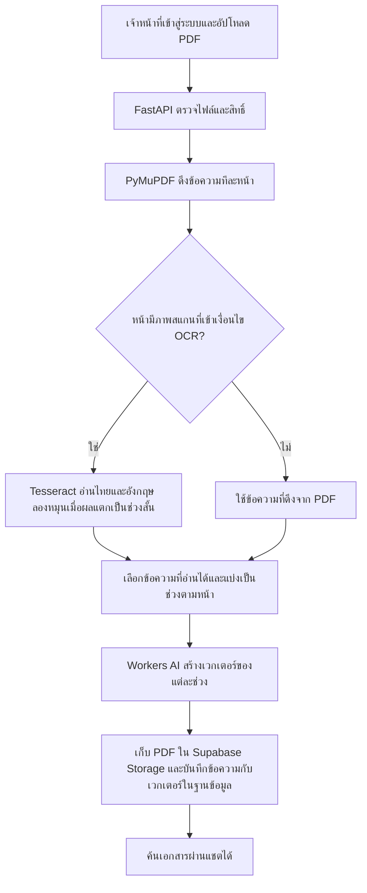

# Flow ระบบผู้ช่วยเทศบาลเมืองศิลา

Render Free ให้บริการหน้าเว็บประชาชน หน้าเจ้าหน้าที่ และ FastAPI จากโดเมนเดียวกัน หลังบ้านเรียก Cloudflare Workers AI เพื่อสร้างเวกเตอร์และข้อความคำตอบ ส่วน Supabase เก็บไฟล์ PDF ข้อความแยกช่วง เวกเตอร์ และประวัติแชตตามการตั้งค่าของผู้ใช้

## ประชาชนถามคำถาม

ถ้าผู้ใช้เลือกเก็บประวัติ หลังบ้านบันทึกข้อความลง Supabase สำหรับบทสนทนาต่อเนื่อง ผู้ใช้ที่ส่งคำถามแบบไม่เก็บประวัติยังถามและรับคำตอบได้

การขอให้โมเดลจัดคำตอบใหม่ใช้หลักฐานชุดเดิม และอยู่ในกรอบเวลารวมของการสร้างคำตอบ

## เจ้าหน้าที่เพิ่ม PDF

เวกเตอร์ Gemini เดิมและเวกเตอร์ Cloudflare ใช้คนละดัชนี เอกสารเดิมจะค้นผ่าน Workers AI ได้เมื่อสร้างเวกเตอร์ Cloudflare จากเอกสารที่ตรวจแล้ว คู่มือและผลวัดอยู่ใน [QUALITY_EVALUATION.md](QUALITY_EVALUATION.md)
